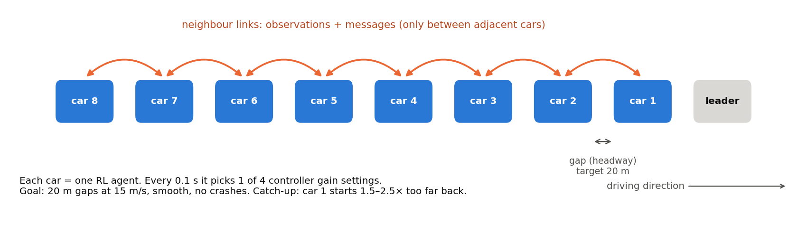
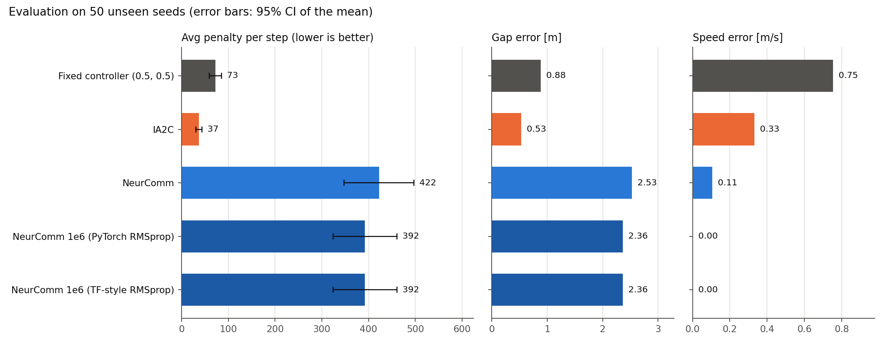
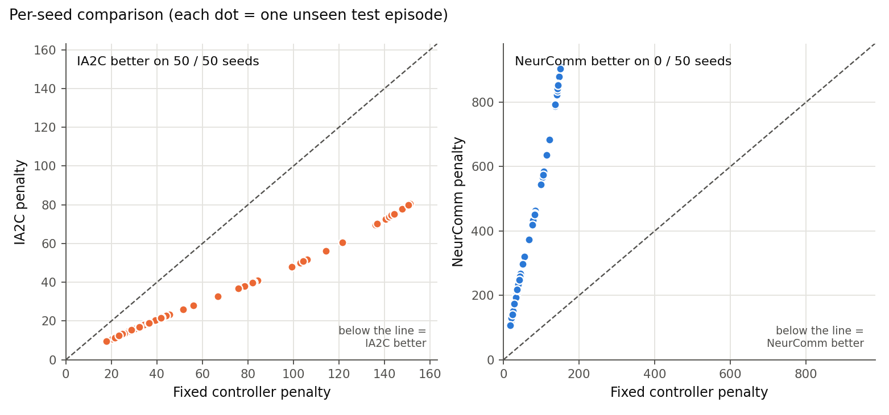
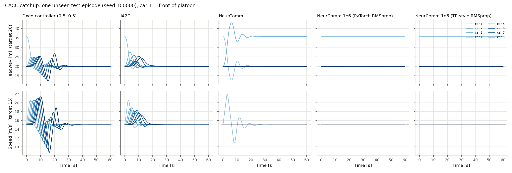
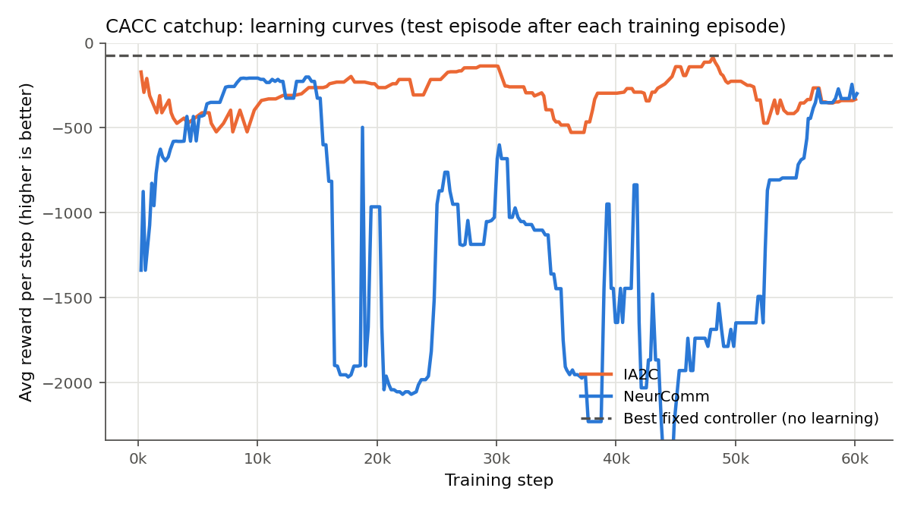
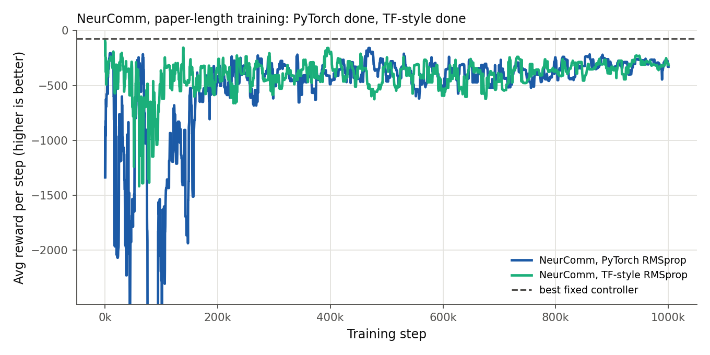
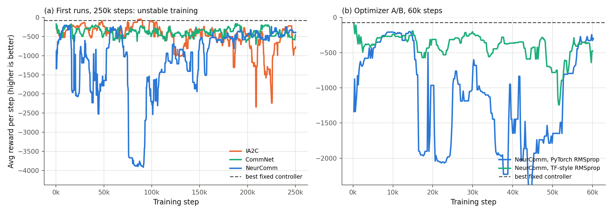

# Networked multi-agent RL for cooperative cruise control

Reproduction of Chu, Chinchali & Katti, "Multi-agent RL for Networked System Control" (ICLR 2020), CACC catch-up scenario. Generated 07 Oct 2026, 15:15.

## Summary

- **IA2C learned a better controller than the hand-tuned baseline**: average penalty 37.2 vs 72.7 (49% lower), better on 50 of 50 unseen seeds, with no collisions.
- Gap error 0.53 m vs 0.88 m and speed error 0.33 vs 0.75 m/s: the learned platoon tracks its targets more closely.
- NeurComm (the paper's method) did not beat the baseline even with paper-length training (best 392.4 vs 72.7): a reproduction gap worth investigating.
- All runs use the authors' code and the paper's hyperparameters; results are from one training seed per method and 50 unseen test seeds.

## 1. Task



*Eight cars follow a leader. Each car is an agent that only sees and talks to the cars directly in front and behind.*

- **State per car (5 numbers):** speed error, speed gap to the car ahead, gap to the controller's target speed, gap error, acceleration (IA2C also sees its neighbours' states).
- **Action:** one of 4 gain settings (α, β) of an optimal-velocity car-following controller.
- **Reward:** −(gap error)² − (speed error)² − 0.1·accel², large penalty on collision; summed over all cars (cooperative).
- **Algorithms:** IA2C (independent actor-critic using neighbour observations; critic sees neighbour actions) and NeurComm (adds learned messages: each car sends its neighbours its state, last policy and LSTM memory every step, `agents/policies.py:229-250`).

## 2. Main results

| Method | Reward (mean ± std) | 95% CI | Collisions | Gap err [m] | Speed err [m/s] | Beats fixed on | Evaluated checkpoint |
|---|---|---|---|---|---|---|---|
| Fixed controller (0.5, 0.5), no learning | -72.7 ± 46.5 | ± 12.9 | 0 / 50 | 0.88 | 0.75 | — | — |
| **IA2C** | -37.2 ± 23.9 | ± 6.6 | 0 / 50 | 0.53 | 0.33 | 50 / 50 seeds | best @ 27.1k of 60k steps |
| NeurComm | -422.3 ± 270.4 | ± 74.9 | 0 / 50 | 2.53 | 0.11 | 0 / 50 seeds | best @ 8.8k of 60k steps |
| NeurComm 1e6 (PyTorch RMSprop) | -392.4 ± 245.0 | ± 67.9 | 0 / 50 | 2.36 | 0.00 | 0 / 50 seeds | best @ 469.6k of 1000k steps |
| NeurComm 1e6 (TF-style RMSprop) | -392.4 ± 245.0 | ± 67.9 | 0 / 50 | 2.36 | 0.00 | 0 / 50 seeds | best @ 396.1k of 1000k steps |



*Lower is better in all three panels. Grey = no-learning baseline.*



*Each dot is one unseen test episode. Points below the diagonal are seeds where the learned method beat the fixed controller.*

## 3. Behaviour: does the platoon coordinate?



*Gap (top) and speed (bottom) of all 8 cars in one unseen episode. Dotted line = target.*

- **Fixed controller:** the disturbance from car 1 travels down the platoon and **grows** (string instability): later cars dip to smaller gaps and take longer to settle.
- **IA2C:** the wave **shrinks** down the platoon and settles sooner: the agents learned to coordinate.
- **NeurComm (60k steps):** car 1 closes its gap but car 2 does not respond, so the gap moves back to car 2: a "do nothing" local optimum.
- **NeurComm (1e6 steps, both optimizers):** no car ever changes speed. All cars hold 15 m/s and car 1 never closes its gap. Longer training made the "do nothing" optimum more complete, not less.

## 4. Training



*Reward of a test episode after each training episode (rolling median of 15). Dashed = best fixed controller.*

Single-seed RL training is noisy, so the reported model is the checkpoint with the best rolling validation reward. Validation seeds are separate from the 50 evaluation seeds.

## 5. NeurComm with paper-length training

- PyTorch RMSprop: finished, evaluated best checkpoint → reward -392.4, 0 / 50 collisions.
- TF-style RMSprop: finished, evaluated best checkpoint → reward -392.4, 0 / 50 collisions.



*NeurComm training reward over the paper's 1e6 steps, two optimizer implementations.*

## 6. Reproduction findings



*(a) With the original settings, rewards swing widely for all methods. (b) A TensorFlow-matching optimizer removes NeurComm's crash phase but does not improve the final policy.*

| Finding | Evidence | Consequence |
|---|---|---|
| Training is unstable with the paper's settings | Fig. 6a: IA2C briefly reached the baseline, then fell back; NeurComm swung widely | Report the best validation checkpoint, not the last |
| PyTorch vs TF1 RMSprop differ (state init 0 vs 1, ε outside vs inside √) | TF-style version: NeurComm crash-like episodes 47% → 18% (last third of training); IA2C worse | Not the main cause; kept as an option (`optimizer = rmsprop_tf`) |
| Model selection is decisive | IA2C: last checkpoint worse than baseline; best validation checkpoint beats it | Best-checkpoint saving added to the trainer |
| Seed overlap risk | Training seeds count up by 2 per episode (reached ~2000 at 250k steps) | Evaluation moved to seeds 100000+ |

## 7. Setup

| Item | Value |
|---|---|
| Scenario | CACC catch-up: 8 cars, 60 s episodes, 0.1 s control step |
| Targets | gap 20 m, speed 15 m/s; collision if gap < 1 m |
| Learner | A2C, LSTM 64 units, FC 64 units, RMSprop lr 5e-4, γ 0.99, entropy 0.05 (IA2C 0.05) |
| Rollout | 60 steps per update; reward / 5000.0 |
| Hyperparameters | the paper's configs (`config/`), only training length changed |
| Training | 60k steps per method, 1 training seed |
| Model selection | checkpoint with the best rolling mean of 5 validation episodes (validation seeds never overlap evaluation seeds) |
| Evaluation | 50 unseen seeds (100000–100490), deterministic policy |
| Baseline | same OVM car-following controller with the best of its 4 fixed gain presets |

### All fixed-controller presets (same 50 seeds)

| Preset (α, β) | Reward | Collisions |
|---|---|---|
| (0, 0) | -392.4 ± 245.0 | 0 / 50 |
| (0.5, 0) | -1684.9 ± 532.8 | 50 / 50 |
| (0, 0.5) | -392.4 ± 245.0 | 0 / 50 |
| (0.5, 0.5) | -72.7 ± 46.5 | 0 / 50 |

## 8. Limitations and next steps

- One training seed per method: needs 3+ seeds for error bars across training runs.
- NeurComm converged to a "do nothing" policy even with paper-length training, so the paper's NeurComm result was not reproduced here. Next: multiple seeds, spatial discount (`coop_gamma`; the shipped NeurComm configs use −1 = global reward), entropy/learning-rate sensitivity.
- Slow-down scenario not yet solved (first 250k-step runs crashed on all test seeds).
- Agents are decentralised in what they observe, but simulated and trained in one process. Next: one process per car with message queues (truly distributed execution).
- Traffic-signal (ATSC) scenarios need the SUMO simulator.

## How to reproduce

```bash
python demo/run_demo.py --steps 6e4 --algos ma2c_nc,ia2c --scenarios catchup --out demo/runs_repro
python demo/make_report.py --runs demo/runs_repro --out demo/results_repro
python demo/build_presentation.py   # rebuilds this report from demo/runs
```
