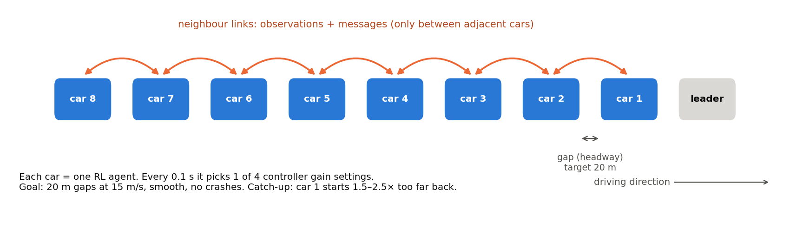
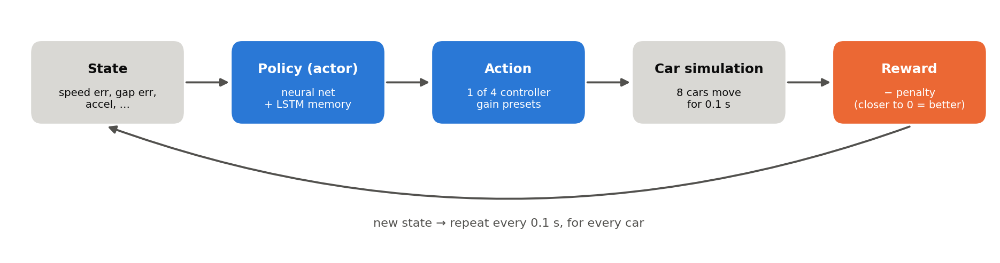
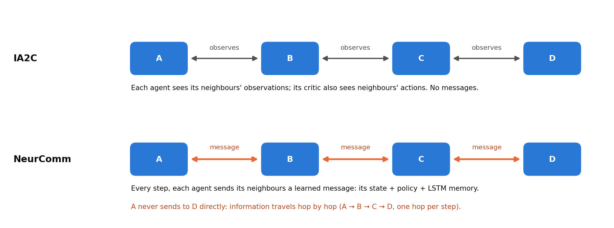
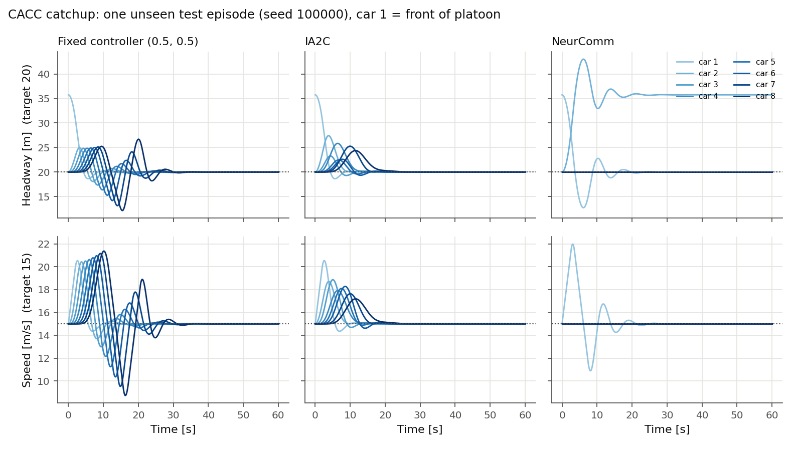
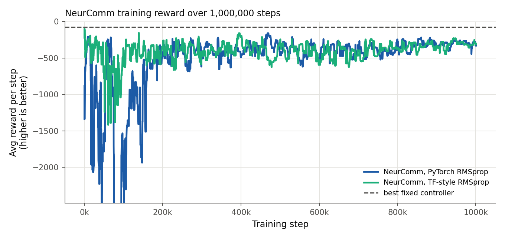
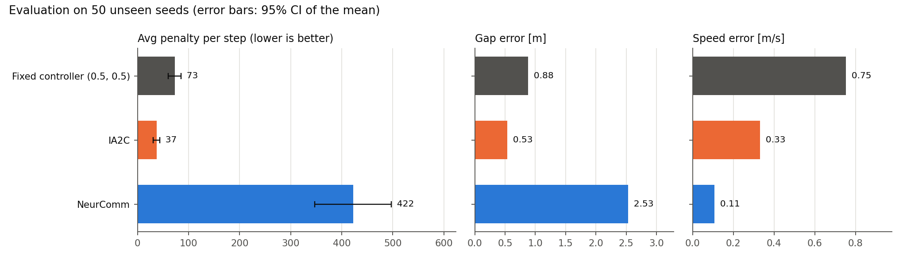
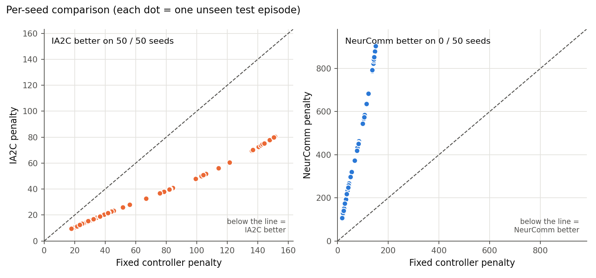
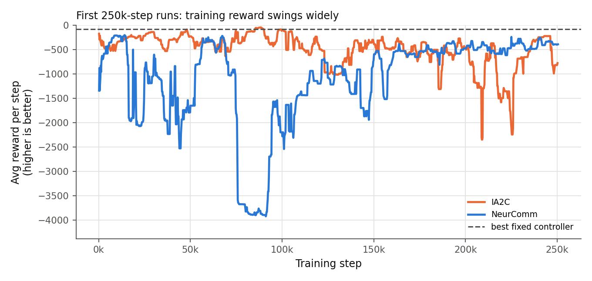

# Multi-agent RL for cooperative cruise control: reproduction

We implemented and reproduced the CACC part of the paper "Multi-agent Reinforcement Learning for Networked System Control" (Chu, Chinchali & Katti, ICLR 2020). Below: the problem, the RL method, how we implemented and tested it, and what we found, including why NeurComm did not reproduce the expected performance.

## 1. Problem

*Eight cars follow a leader. Each car is an agent; cars mainly interact with their neighbours.*

- **Target:** about **15 m/s** speed and a **20 m** gap to the car ahead.
- **Challenge, coordination:** if one car changes speed, the disturbance can propagate down the platoon.
- **Question:** can multi-agent RL control the platoon better than a fixed controller?

## 2. Reinforcement learning in one picture

*The RL loop: observe the state, choose an action, receive a reward, repeat.*

- **State:** quantities such as speed error, gap information and acceleration.
- **Action:** one of **four controller gain settings** for the car-following (OVM) controller, **not** raw acceleration.
- **Reward:** a negative penalty for gap error, speed error and acceleration, with a large collision penalty. **Closer to zero is better.**

## 3. The learning method: A2C

- **Actor:** chooses the action.
- **Critic:** estimates how good the current situation is.
- **Advantage:** after the outcome, was it better or worse than the critic expected? The actor is pushed towards actions that turned out better than expected.
- **LSTM:** gives the agent memory, useful when the current observation does not tell the whole story.

## 4. Two multi-agent variants: IA2C vs NeurComm

*IA2C uses neighbour information without messages; NeurComm adds learned messages between neighbours.*

## 5. How we implemented it

| Item | Value |
|---|---|
| Code and settings | The authors' CACC implementation with the paper's configuration files |
| Task | 8 cars, 60 s episodes, 0.1 s control step |
| Learner | A2C with a 64-unit LSTM and 64-unit fully connected layer |
| Training | 60k steps per method, one training seed per method |
| Model selection | checkpoint with the best rolling mean over 5 validation episodes (not simply the last one) |

## 6. How we tested it

| Item | Value |
|---|---|
| Test scenarios | 50 unseen seeds, separate from training and validation |
| Policy at test time | deterministic (always the most likely action) |
| Metrics | average reward per step, gap error, speed error, collisions |
| Baseline | the 4 fixed controller presets on the same seeds; the best one is the baseline |

### Fixed controller presets on the same 50 test seeds

| Preset (α, β) | Avg reward per step | Collisions |
|---|---|---|
| (0, 0) | -392.4 | 0 / 50 |
| (0.5, 0) | -1684.9 | 50 / 50 |
| (0, 0.5) | -392.4 | 0 / 50 |
| (0.5, 0.5)  ← baseline | -72.7 | 0 / 50 |

## 7. Results

| Method | Avg reward per step (mean ± std) | Gap error [m] | Speed error [m/s] | Collisions | Better than fixed on |
|---|---|---|---|---|---|
| Fixed controller (0.5, 0.5) (baseline, no learning) | -72.7 ± 46.5 | 0.88 | 0.75 | 0 / 50 | — |
| **IA2C** | -37.2 ± 23.9 | 0.53 | 0.33 | 0 / 50 | 50 / 50 seeds |
| NeurComm | -422.3 ± 270.4 | 2.53 | 0.11 | 0 / 50 | 0 / 50 seeds |

**IA2C beat the fixed baseline:** -37.2 vs -72.7 average reward per step (49% less penalty), better on 50 of 50 seeds, with 0 collisions.

> **Key interpretation:** NeurComm's low speed error (0.11 m/s) does **not** mean it performed well. It kept speed close to 15 m/s but failed to correct the 20 m spacing (gap error 2.53 m), which hurt the total reward.

*One unseen test episode. Top: gap of each car; bottom: speed. Dotted line = target.*

- **Fixed controller:** the disturbance grows as it travels down the platoon, and later cars take longer to settle.
- **IA2C:** the disturbance shrinks down the platoon and settles sooner. What it learned is a per-car combination of settings (cars 2, 4, 7, 8 use (0, 0.5); cars 1, 3, 5, 6 use (0.5, 0.5)) that works better than giving every car the same setting.
- **NeurComm:** car 1 closes its gap, but car 2 does not respond properly, so the large gap simply moves back to car 2.

## 8. NeurComm with the paper's full training length

| Run | Avg reward per step | Gap error [m] | Speed error [m/s] | Collisions | Best checkpoint at |
|---|---|---|---|---|---|
| NeurComm, 1,000,000 steps (PyTorch RMSprop) | -392.4 | 2.36 | 0.00 | 0 / 50 | 470k |
| NeurComm, 1,000,000 steps (TF-style RMSprop) | -392.4 | 2.36 | 0.00 | 0 / 50 | 396k |

With 1,000,000 training steps (with either optimizer version) the behaviour became even more complete: the cars essentially stayed at 15 m/s and car 1 never closed its gap (speed error 0.00). Longer training did not fix it.

*NeurComm training reward stays below the fixed baseline (dashed) for the whole run.*

## 9. Why NeurComm performed poorly, and what it means

- **Observed failure mode, a "do nothing" local optimum:** not accelerating never causes a crash, but it never corrects the gap. That gives low speed error but high gap error, so the total reward stays poor.
- **Training was unstable.** We tested a TensorFlow-style RMSprop variant (the paper's original optimizer). It reduced some crash-like training behaviour, but the final NeurComm policy remained poor.
- **No single proven root cause:** with one training seed we can report what we observed, not prove that communication itself is the cause.
- **What it means:** adding communication does not automatically produce better coordination. It gives a richer model, but the learning problem can also become harder. IA2C learned useful coordination in our reproduction; NeurComm did not reproduce the paper's benefit.

## 10. Limitations

- **One training seed per method:** more seeds are needed before making a strong statistical claim.
- **NeurComm sensitivity:** spatial discounting, entropy and learning rate still need to be studied.
- **One process:** all agents are simulated in a single process; truly distributed execution, with one process per car, is future work.

## 11. Summary

> Implement the paper → train the agents → select the best validation checkpoint → test on 50 unseen seeds → compare with the best fixed controller.

IA2C improved substantially over the baseline. NeurComm did not; it converged towards a do-nothing solution. That is our main reproduction finding and the main question for further investigation.

---

## Backup (only if asked)

*The main results as bars (95% confidence intervals of the mean).*

*Per-seed comparison: each dot is one test episode; below the line = the learned method was better.*

*Why we select the best validation checkpoint: in our first 250k-step runs, training reward swung widely.*
