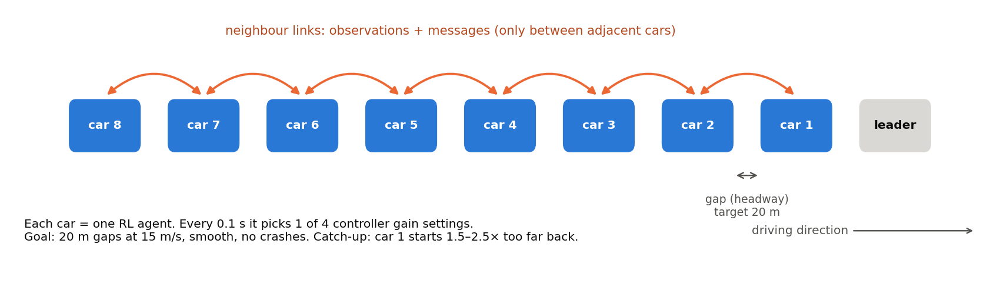
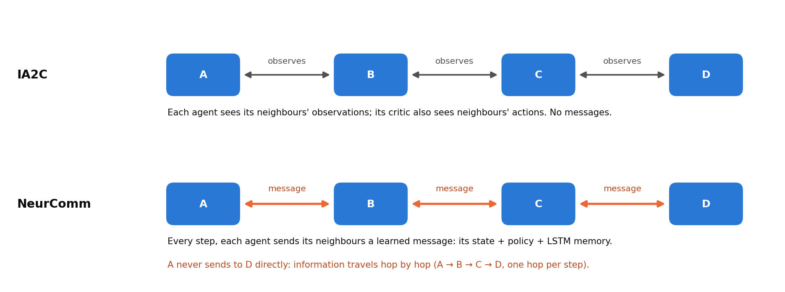
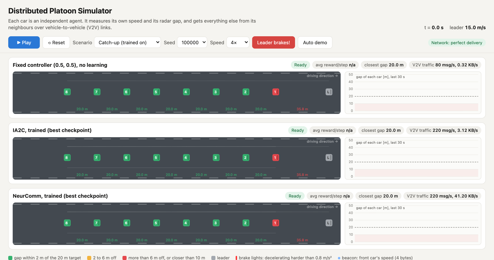
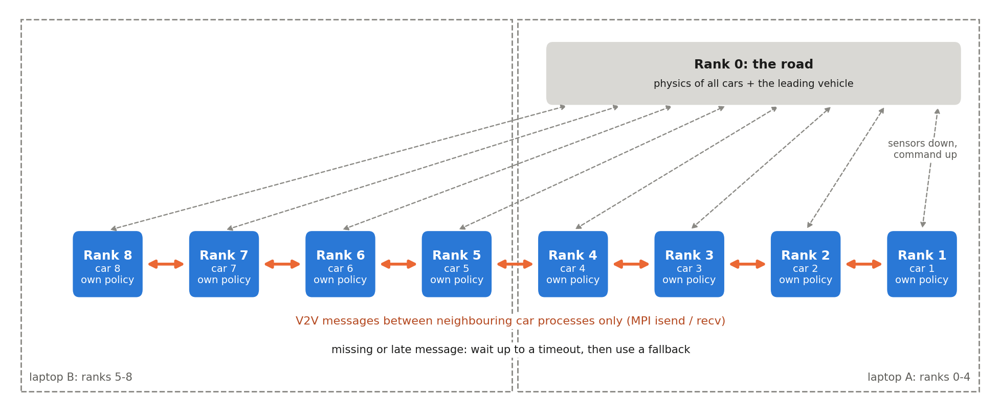
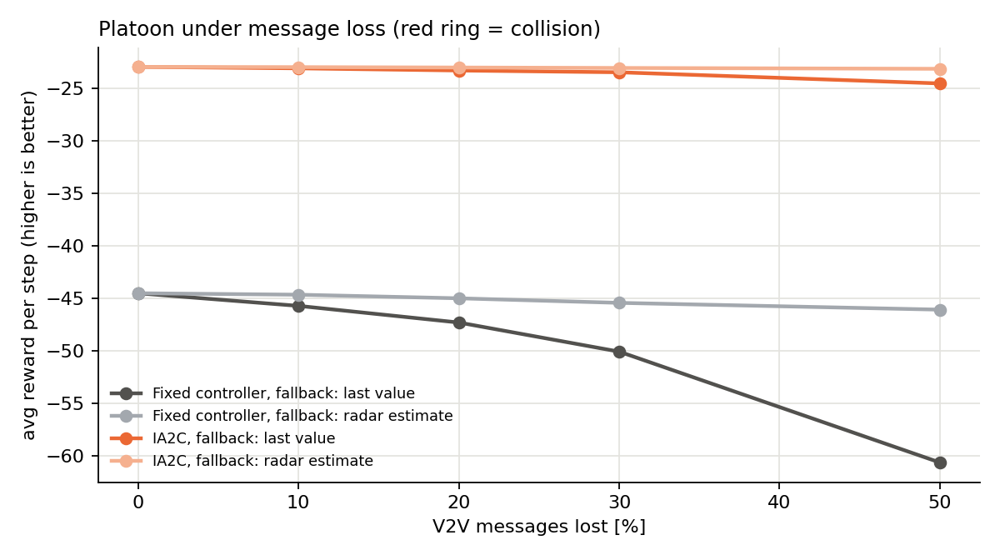
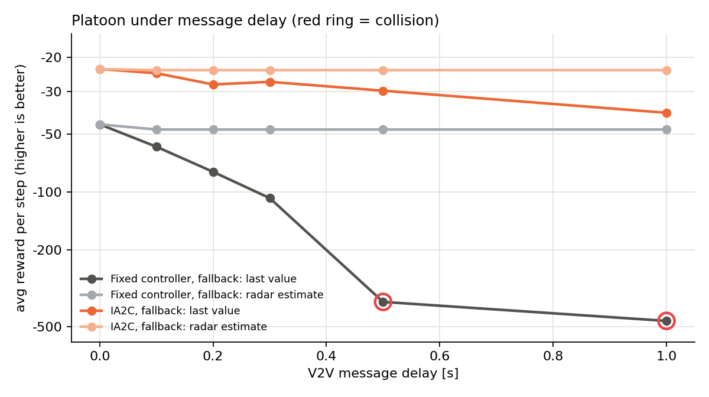
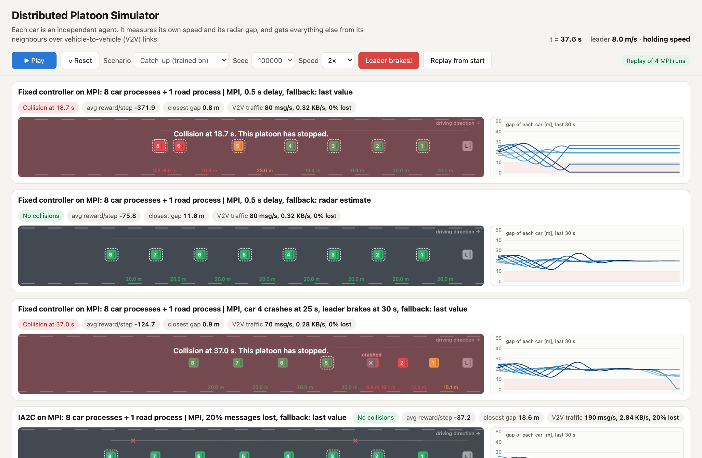
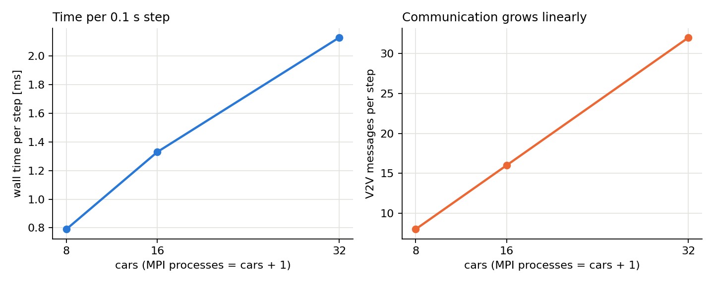

# Distributed multi-agent RL for cooperative driving

We took the paper "Multi-agent Reinforcement Learning for Networked System Control" (Chu et al., ICLR 2020), reproduced its car-platoon experiment, and then ran the learned controllers as a real distributed system on MPI: one process per car, talking only by messages, with network faults injected on purpose.

## 1. Problem

*Eight cars follow a leader. Each car is an agent that only talks to its neighbours.*

- **Goal:** every car keeps a 20 m gap at 15 m/s, smoothly and without crashing.
- **Challenge:** one car's speed change travels down the platoon and can grow into a wave.
- **Our project:** agents that learn locally and coordinate by messages, and keep working when the network is unreliable.

## 2. The paper in one picture

*IA2C uses neighbour information; NeurComm also sends learned messages.*

- **Learning:** each car learns by trial and error (A2C: an actor picks actions, a critic judges them).
- **Spatial discount:** a car cares more about nearby cars' rewards than far ones.
- **NeurComm:** each step, a car sends its neighbours its state, policy and memory.

## 3. Reproduction: did we get the paper's result?

| Method | Setting | Seed 12 | Seed 13 | Seed 14 | Mean |
|---|---|---|---|---|---|
| Fixed controller | no learning | -72.7 |  |  | **-72.7** |
| IA2C | global reward, 60k steps | -37.2 | -94.5 | -374.6 | -168.8 |
| NeurComm | global reward (as released), 60k steps | -422.3 | -392.4 | -392.4 | -402.3 |
| NeurComm | spatial discount 0.9, 60k steps | -176.8 | -94.3 | -392.4 | -221.1 |

> **Partly.** IA2C can beat the hand-tuned controller, but only on one of three training seeds. NeurComm, the paper's method, does not reproduce: with the released settings it learns to do nothing. Switching on the paper's spatial discount helps it a lot, but it still stays below the fixed controller. Average reward per step on 50 unseen test seeds; closer to 0 is better.

## 4. A visual simulator

*Three platoons side by side, moments after the leader brakes. Dots are V2V messages; red lights are braking cars.*

## 5. Running it on MPI

*One MPI process per car plus one for the road. Cars exchange messages only with their neighbours.*

- **Every 0.1 s:** the road sends each car its own sensor readings; neighbouring cars exchange messages; each car runs its own trained policy and sends back an acceleration command.
- **No shared memory:** a car process holds only its own neural network and knows only its own sensors plus received messages.
- **Same algorithm:** with no faults the MPI run equals the Python run at every one of 600 steps (IA2C −22.96, fixed −44.51).
- **Two laptops:** the same program runs across two machines with a hostfile; cars 4 and 5 then talk over real Wi-Fi.

## 6. Breaking the network on purpose

### Lost messages

| Fault | Fixed, last value | Fixed, radar | IA2C, last value | IA2C, radar |
|---|---|---|---|---|
| 0% lost | -44.5 | -44.5 | -23.0 | -23.0 |
| 20% lost | -47.3 | -45.0 | -23.3 | -23.0 |
| 50% lost | -60.6 | -46.1 | -24.5 | -23.1 |

*Average reward per step as more V2V messages are lost.*

### Late messages

| Fault | Fixed, last value | Fixed, radar | IA2C, last value | IA2C, radar |
|---|---|---|---|---|
| 0.0 s late | -44.5 | -44.5 | -23.0 | -23.0 |
| 0.3 s late | -107.5 | -47.3 | -26.8 | -23.3 |
| 0.5 s late | **crash at 18.7 s** | -47.3 | -29.8 | -23.3 |
| 1.0 s late | **crash at 15.9 s** | -47.3 | -38.8 | -23.3 |

*Average reward per step as messages arrive later (red ring = collision).*

### A car process crashes

*MPI runs replayed: late messages crash the platoon unless the cars use their radar (lanes 1 and 2); a crashed car cannot brake (lane 3).*

> **Lessons.** (1) Late information is far more dangerous than lost information. (2) Falling back on local sensing (radar) makes the platoon tolerate any delay we tried. (3) Detecting a crashed node is not enough: it must have a safe behaviour of its own.

## 7. Scaling

*Time per step and messages per step as the platoon grows.*

| Cars | MPI processes | Time per 0.1 s step | V2V messages per step |
|---|---|---|---|
| 8 | 9 | 0.8 ms | 8 |
| 16 | 17 | 1.3 ms | 16 |
| 32 | 33 | 2.1 ms | 32 |

Cost grows about linearly and stays far below the 100 ms real-time budget. In full 60 s runs, 16 and 32 cars collide with the hand-tuned controller (also in plain Python): the wave grows down a longer platoon.

## 8. What is distributed, honestly

| Part | Distributed? |
|---|---|
| Running the trained cars (execution) | Yes: separate MPI processes, message passing only, timeouts, fallbacks |
| Training the policies | Not yet: one program on one machine |
| The road (physics) | One process: it plays the real world, not a controller |
| Network faults | Injected by our code (loss, delay, crash) |
| Machines | One laptop tested; two-laptop setup ready |

## 9. Next steps

- Longer NeurComm training with the spatial discount (running), to close the reproduction gap.
- Run across two laptops for the demo.
- Distributed training: each car process learns, and neighbours average their networks over MPI.
