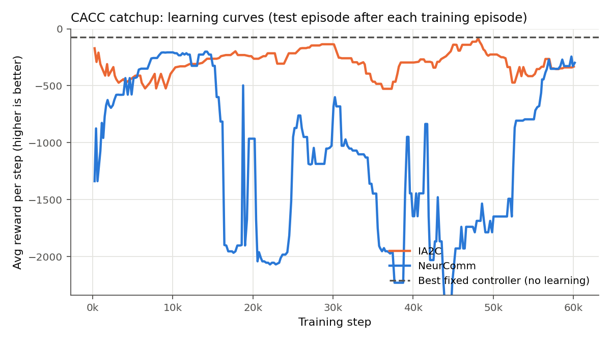
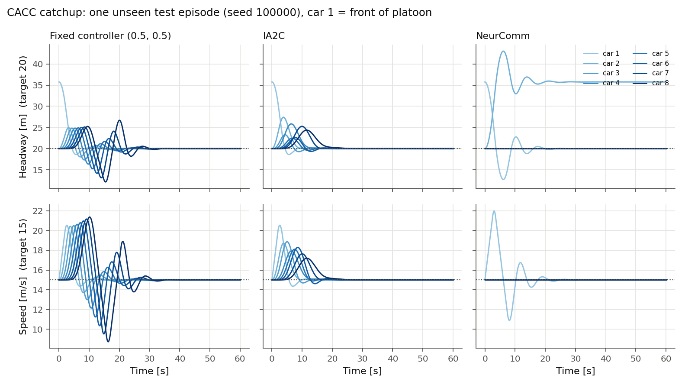

# Demo results

Evaluation: 50 unseen test seeds (100000–100490), deterministic policy. Reward is the average per-step platoon reward (higher is better, 0 is perfect). Errors are mean absolute deviation from target headway / speed over all cars and steps. "best checkpoint" = the training checkpoint with the highest rolling mean of 5 validation episodes; validation seeds count up from 11 and stay far below the evaluation seeds.

## CACC catchup

| Method | Reward (mean ± std) | Collisions | Headway err [m] | Speed err [m/s] |
|---|---|---|---|---|
| Fixed controller, preset (0.5, 0.5) (no learning) | -72.7 ± 46.5 | 0 / 50 | 0.88 | 0.75 |
| IA2C (best checkpoint @ 27.1k of 60k steps) | -37.2 ± 23.9 | 0 / 50 | 0.53 | 0.33 |
| NeurComm (best checkpoint @ 8.8k of 60k steps) | -422.3 ± 270.4 | 0 / 50 | 2.53 | 0.11 |

